# earth4222-unlocked

A home control panel that runs **on an ISP fibre router** — no Raspberry Pi, no app, no cloud.
The router (an EARTH-4222 EPON ONT on a Realtek RTL9607C, MIPS32r2 big-endian, BusyBox 1.22, root SSH)
serves a small web app at **`http://tazer`** from its own shell and GNU `netcat`, and drives a WiZ smart bulb over UDP.

📖 **The story behind it:** [read the write-up on Medium](https://tazer.medium.com/71622c05e004?source=friends_link&sk=ba25aa24f362652710bf1ae2bf0f11c1)

<picture>
  <source media="(prefers-color-scheme: dark)" srcset="docs/screenshots/overview-dark.png">
  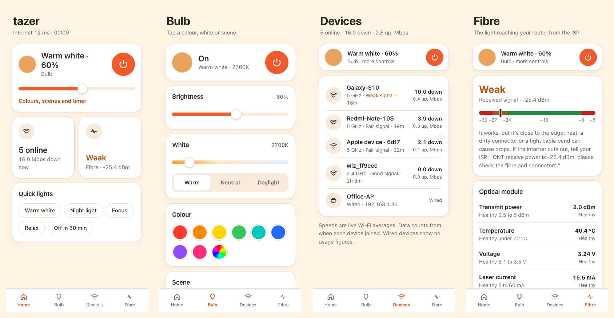
</picture>

<sub>Home · Bulb · Devices · Fibre, at phone size. Captured from a local stand-in serving the same pages with real readings; device names changed.</sub>

## Screenshots

Phone (follows the system's light or dark setting):

| Page | Light | Dark |
|---|---|---|
| **Home** | 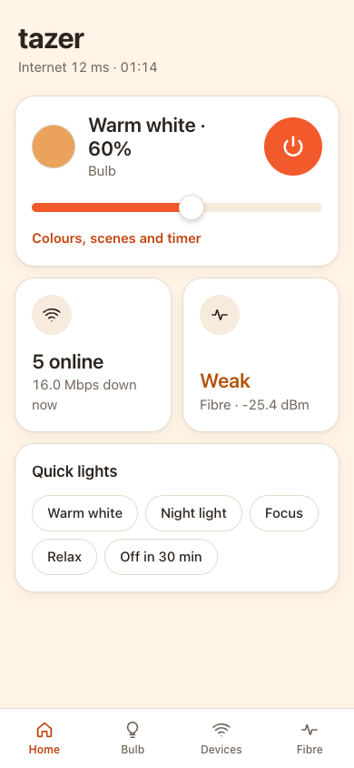 | 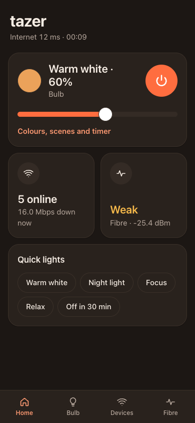 |
| **Bulb** | 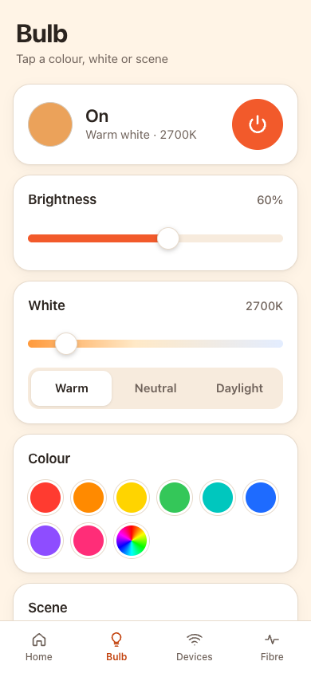 | 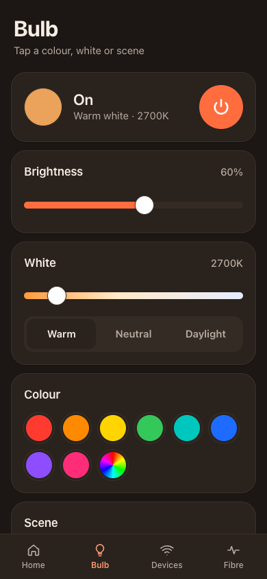 |
| **Devices** | 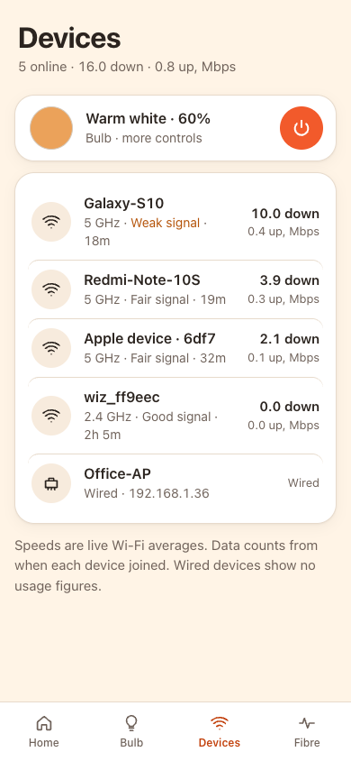 | 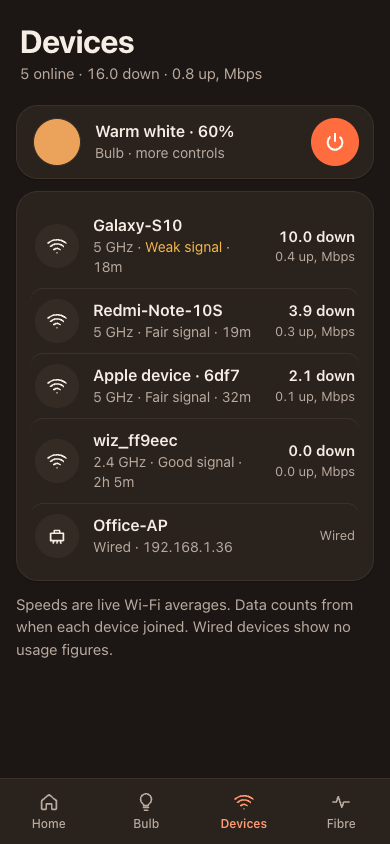 |
| **Fibre** | 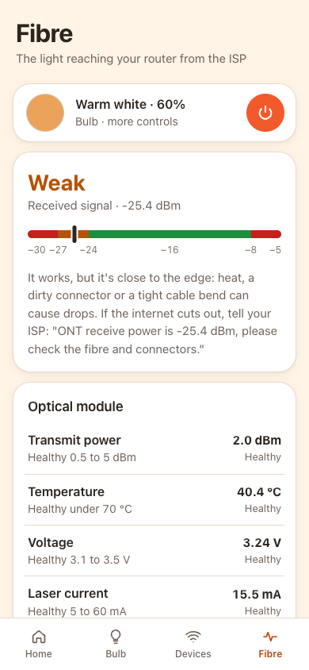 | 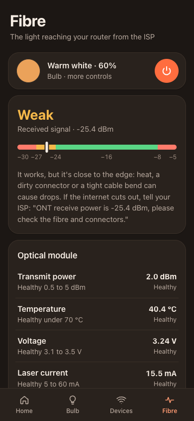 |

Mac / wide screens (two columns):

| Light | Dark |
|---|---|
| 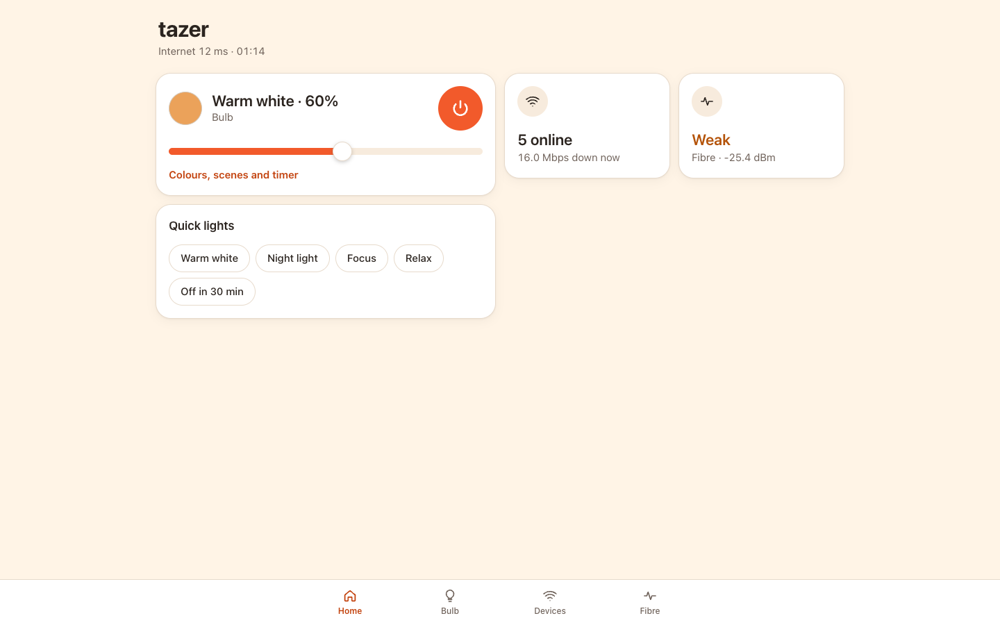 | 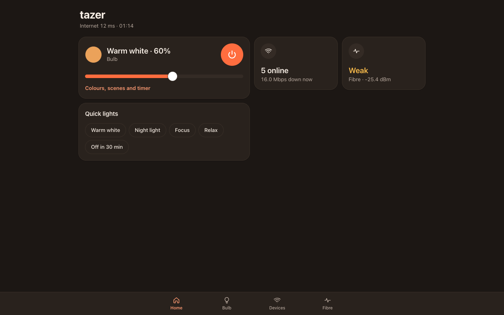 |

<sub>Captured from a local stand-in serving the same pages with real readings; device names changed.</sub>

## What it does
- **Bulb** — on/off, brightness, white temperature, colours, WiZ scenes and speed, sleep timer.
- **Devices** — who's on Wi-Fi with a device-type icon (phone, computer, TV, smart home, router) and OS guessed from its name and Wi-Fi chip, band, signal, live ↓/↑ speed and data since joining (from the Wi-Fi driver's `/proc/wlan*/sta_info`), wired devices from the bridge table.
- **Fibre** — optical receive/transmit power, module temperature, voltage and laser current via the router's own `diag` tool, with a healthy/weak/critical verdict.
- **Internet-down alarm** — pings out every 20 s; on an outage the bulb blinks and stays red, then returns to what it showed before.
- **`http://tazer`** — a spare LAN IP on the router, port 80 redirected to the app, and a side `dnsmasq` answering the name.

## Layout
```
router/            everything that runs on the router (all in RAM: /run/wiz)
  wiz.sh           HTTP handler + bulb/devices/fibre/timer API + alarm loop (deployed as /run/wiz/sh)
  up.sh            starts the server, the alarm, the name/DNS setup; prints a checklist
  deploy.sh        copies it all to the router and runs up.sh (run again after a router reboot)
  config.example.sh  copy to config.sh: your bulb's MAC and fallback IP (config.sh is git-ignored)
  pages/           the web app: home, bulb, devices, fibre + style.css
  PRODUCT.md       product brief (impeccable design skill)
bulb.sh, make_shortcut.py, Bulb.shortcut   macOS Shortcuts menu that talks to the bulb directly
firmware/          read-only dump of the router: flash partitions, settings XML (credentials masked), vendor web server
archive/           things that didn't work, with notes (captive-portal welcome pop-up, official BusyBox MIPS builds)
```

## Setup
1. `cp router/config.example.sh router/config.sh` and fill in your bulb's MAC.
2. `router/deploy.sh` (asks for the router's root password once).
3. Open `http://tazer` on any device on the Wi-Fi.

Everything lives in router RAM, so a router reboot wipes it — run `deploy.sh` again.

## Router quirks this works around
- No `httpd`, no UDP in BusyBox `nc`; official busybox.net MIPS builds crash (illegal instruction). The router's own **GNU netcat 0.7.1** does UDP (`-u`) but never exits, so the handler waits for the reply and kills it.
- `netcat -e PROG` runs PROG through BusyBox with argv0 = its basename, so the handler file must be named **`sh`**.
- netcat closes with a TCP reset: every response carries `Content-Length` plus a short pause.
- GNU netcat takes one connection per run and needs ~190 ms to re-arm, so three listeners run (8080–8082). The kernel lacks the `statistic`, `multiport`, `u32` and `recent` matches and Macs pick sequential source ports, so connections are spread with the `limit` match as a token bucket: 8081 and 8082 each take at most one new connection per 250 ms, the rest go to 8080. A page and its parallel requests land on different listeners (tested: 30/30 three-at-once requests, no retries). CSS is inlined into each page at deploy and the home page fetches everything in one `/api?a=home` call.
- **dropbear 0.48** silently drops remote commands longer than ~1 KB, so deploy copies `up.sh` and runs it instead of inlining.
- The vendor's `configd` regenerates `/var/dnsmasq.conf` whenever dnsmasq restarts — names come from a separate dnsmasq on :5353 with LAN DNS redirected through it (and removed again if it ever fails to start).
- Too many SSH logins in a row make `inetd` disable SSH for a while.
